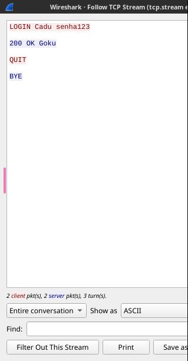

# Relatório — Fase 2: Interceptação Ativa (MITM)

**Disciplina:** Laboratório de Redes de Computadores

**Grupo:** Carlos Eduardo Alves Pereira Cunha, Bryan Melo Coelho e Eduardo Carlesso Silveira.

As evidências deste relatório foram obtidas na validação realizada em 26/10/2026. Os arquivos originais estão em [evidencias/fase2](evidencias/fase2/). Os comandos atuais de montagem, execução e limpeza estão no [README](../README.md).

## 1. Resumo

O objetivo desta fase é demonstrar a alteração de mensagens de um protocolo de aplicação sem proteção de integridade e sem autenticação do servidor. Para isso, utilizamos o PLP — PUCRS Login Protocol, implementado na Fase 1, e acrescentamos um proxy entre o cliente e o servidor.

O proxy foi desenvolvido em Python com sockets TCP e atende múltiplas conexões simultâneas. Ele recebe as mensagens do cliente, permite substituir as credenciais de LOGIN e encaminha o conteúdo ao servidor. A resposta verdadeira do servidor é devolvida ao cliente. A comparação entre os logs e os pacotes capturados demonstrou que o cliente enviou as credenciais de Cadu, mas o servidor recebeu e autenticou Goku.

## 2. Topologia utilizada

Foi utilizado **Podman**. Nesta fase, cliente, proxy e servidor executam em containers com identidades de rede próprias.

**Rede:** `lab-net-fase2`, uma bridge interna na sub-rede `192.168.201.0/24`, criada com `--internal`. Na validação, foi conferido `internal: true` e verificada a ausência de rota IPv4 padrão no servidor. Essa configuração restringe acesso externo; não representa isolamento absoluto do host. A interface gráfica publica somente `127.0.0.1:3001` no host; o tráfego PLP permanece interno.

| Nó | Papel | Container | IP na `lab-net-fase2` | Observação |
|---|---|---|---|---|
| servidor | Servidor PLP | `servidor-fase2` | `192.168.201.11` (fixo) | Escuta TCP na porta 9999 e valida as credenciais recebidas. |
| cliente | Cliente PLP | `cliente-fase2` ou nome automático | Dinâmico | Conecta ao proxy na porta 8888; executa LOGIN e QUIT. |
| proxy | Intermediário MITM | `proxy-fase2` | `192.168.201.12` (fixo) | Recebe conexões na porta 8888 e abre outra conexão com o servidor na porta 9999. |

### 2.1 Por que o cliente se conecta ao proxy

O redirecionamento é realizado configurando o destino do cliente, conforme permitido pelo enunciado. Em vez de conectar diretamente ao servidor, o cliente conecta ao endereço do proxy. O proxy recebe essa conexão e abre uma segunda conexão TCP com o servidor verdadeiro.

No requisito 1 da Fase 2, o enunciado especifica: “O redirecionamento do tráfego para o proxy deve ser feito por configuração do próprio serviço, por exemplo, apontando o cliente ao proxy.” Essa é a estratégia adotada; não há exigência de ARP/DNS spoofing.

```text
Cliente → 192.168.201.12:8888 (proxy) → 192.168.201.11:9999 (servidor)
Cliente ← resposta do proxy        ← resposta do servidor
```

O intermediário consegue, assim, ler e modificar a requisição antes de entregá-la ao servidor. Não é necessário realizar ARP spoofing ou alterar as rotas da rede. Diferentemente do sniffer passivo da Fase 1, o proxy participa das conexões e usa sockets TCP normais.

### 2.2. Modo de execução

Dentro da pasta do projeto, execute:

```bash
bash podman/executar_fase2.sh
```

Esse script constrói as imagens `lab-servico` e `lab-proxy`, cria a rede interna e inicia o servidor. Para conferir a inicialização:

```bash
podman logs servidor-fase2
podman network inspect lab-net-fase2
```

Em outro terminal, inicie o proxy com a alteração ativada e credenciais de substituição fixas:

```bash
podman run -it --rm --name proxy-fase2 \
  --network lab-net-fase2 --ip 192.168.201.12 -p 127.0.0.1:3001:3001 \
  lab-proxy python3 -u proxy.py 0.0.0.0 8888 192.168.201.11 9999 \
  --alterar --usuario Goku --senha testeteste
```

Para escolher as credenciais pelo terminal, mantenha `--alterar` e omita `--usuario` e `--senha`. As perguntas são feitas uma única vez, antes de o proxy aceitar conexões. Para o teste sem alteração, omita as três opções: `--alterar`, `--usuario` e `--senha`.

Em um terceiro terminal, inicie o Wireshark com interface web:

```bash
bash podman/wireshark_fase2.sh
```

Abra `https://localhost:3001`, aceite manualmente o certificado local na primeira abertura e, na janela do Wireshark, informe o filtro `tcp port 8888 or tcp port 9999` e dê dois cliques em `eth0`. O container gráfico compartilha a rede do proxy. O Wireshark não precisa estar instalado no host. Aguarde a captura ficar ativa.

Como alternativa sem interface gráfica, use `bash podman/captura_fase2.sh iniciar` antes dos clientes e `bash podman/captura_fase2.sh parar` após os testes. O atalho executa somente o `dumpcap` em um container compartilhando a rede do proxy, com o mesmo filtro. Ele grava em `docs/evidencias/capturas/fase2-DATA-HORA.pcapng` e aguarda o fechamento do arquivo ao finalizar. Não é necessário iniciar o container gráfico nessa opção. Para escolher o nome, acrescente `minha-captura.pcapng` ao comando `iniciar`.

Em um quarto terminal, execute o cliente apontando para o proxy:

```bash
podman run --rm --network lab-net-fase2 \
  lab-servico python3 cliente.py 192.168.201.12 8888 Cadu senha123
```

Para entrada interativa do cliente, acrescente `-it` e omita usuário e senha. As contas de teste disponíveis são as mesmas da Fase 1:

```text
Cadu:  senha123
Goku:  testeteste
Gohan: trabalhoLabRedes
```

Após os testes, clique em **Parar**, o quadrado vermelho do Wireshark. Os pacotes permanecem disponíveis para análise. Use **Arquivo → Salvar como** e salve em `/captures/nome.pcapng`, que corresponde à pasta `docs/evidencias/capturas/` no host. Compare os fluxos cliente–proxy e proxy–servidor usando **Seguir → Fluxo TCP**, em ASCII.

Para trocar entre os modos normal e de alteração, finalize e salve a captura, remova `wireshark-fase2` se estiver usando a interface gráfica, encerre o proxy com Ctrl+C e reinicie-o com as opções correspondentes. Inicie uma nova captura pela opção escolhida para cada comparação. Ao terminar o experimento, salve a captura e execute:

```bash
bash podman/limpar_fase2.sh
```

## 3. Protocolo implementado

Foi mantido o PLP da Fase 1, um protocolo de aplicação próprio em texto claro, sobre **TCP, na porta 9999 do servidor**. O proxy escuta na porta **8888**. As mensagens são codificadas em UTF-8, com campos separados por espaço e uma quebra de linha (`\n`) ao final.

### 3.1 Formato das mensagens PLP

**Cliente → Proxy → Servidor**

```text
LOGIN <usuario> <senha>
QUIT
```

- `LOGIN <usuario> <senha>`: solicita autenticação com as credenciais informadas.
- `QUIT`: solicita o encerramento da sessão.

**Servidor → Proxy → Cliente**

```text
200 OK <usuario>
401 UNAUTHORIZED
400 BAD_REQUEST
BYE
```

- `200 OK <usuario>`: as credenciais recebidas pelo servidor são corretas.
- `401 UNAUTHORIZED`: usuário inexistente ou senha incorreta.
- `400 BAD_REQUEST`: comando desconhecido ou LOGIN malformado.
- `BYE`: confirmação do encerramento.

### 3.2 Funcionamento

O cliente (`servico/cliente.py`) conecta ao endereço do proxy, envia LOGIN, lê a resposta completa, envia QUIT e aguarda BYE. O servidor (`servico/servidor.py`) continua comparando as credenciais recebidas com o dicionário de usuários definido em `servico/protocolo.py`.

O proxy (`proxy/proxy.py`) abre um socket para aceitar clientes e cria outra conexão TCP com o servidor. Os dois lados são lidos em formato binário, uma linha por vez. Isso permite aguardar uma mensagem completa mesmo quando TCP entrega os dados em partes e preservar os bytes que apenas precisam ser encaminhados.

Com `--alterar`, as credenciais de todo LOGIN bem formado são substituídas pelas configuradas na inicialização. A mensagem original e a modificada são registradas no log. Outros comandos e as respostas do servidor são encaminhados sem substituição. Um LOGIN já idêntico ao configurado não precisa ser alterado.

Na demonstração, a transformação foi:

```text
Mensagem enviada pelo cliente: LOGIN Cadu senha123
Mensagem entregue ao servidor: LOGIN Goku testeteste
Resposta verdadeira do servidor: 200 OK Goku
```

### 3.3 Por que o protocolo é vulnerável

O protocolo continua propositalmente sem os mecanismos de defesa que serão tratados na etapa seguinte:

- Sem criptografia: usuário, senha, comandos e respostas são legíveis.
- Sem proteção criptográfica de integridade: o servidor não detecta a alteração do conteúdo em trânsito.
- Sem autenticação do servidor no cliente: o cliente conecta ao intermediário configurado e exibe sua resposta.
- Sem conferência, no cliente, de que o usuário retornado é o mesmo solicitado.

A demonstração utiliza contas de teste conhecidas. O servidor continua validando a senha que recebe; o proxy não descobre uma senha desconhecida nem dispensa essa comparação. O alvo implementa apenas o login, sem um recurso protegido posterior.

### 3.4 Concorrência e regiões críticas

A thread principal do proxy permanece no `accept()` e cria uma thread para cada cliente. Cada atendimento possui sockets, leitores com buffer, requisição e resposta próprios. Isso permite que uma conexão aguarde dados enquanto outras continuam sendo atendidas.

A mensagem de substituição é construída antes das threads e compartilhada como um objeto `bytes` imutável. O único recurso compartilhado que exige exclusão mútua é a saída dos logs. Um `threading.Lock` protege cada registro no terminal, sem bloquear as operações de rede das outras sessões.

Cada sessão possui timeout de 60 segundos de espera por operação e limite de 4.096 bytes por linha. Linhas vazias recebem 400 no proxy; linhas acima do limite ou encerradas antes de `\n` fecham a sessão afetada. Erros de rede e desconexões são tratados no atendimento daquele cliente. Não há limite global de threads, e o timeout não é um prazo total de duração da sessão.

## 4. Execução do experimento

Os testes foram realizados com o servidor ativo e o cliente conectado ao proxy. Foram comparadas execuções sem alteração e com substituição para `Goku/testeteste`. Os trechos abaixo foram extraídos dos arquivos salvos em `evidencias/fase2/`.

### Exemplo 1 — Saída 200 sem alteração

Com o proxy iniciado sem `--alterar`, entrada do cliente:

```bash
podman run --rm --network lab-net-fase2 \
  lab-servico python3 cliente.py 192.168.201.12 8888 Cadu senha123
```

Saída do cliente:

```text
Conectando a 192.168.201.12:8888 ...
Enviando (texto claro): b'LOGIN Cadu senha123\n'
Resposta do servidor: 200 OK Cadu
Servidor: BYE
```

Saída do proxy:

```text
[192.168.201.2:46836] cliente -> servidor: b'LOGIN Cadu senha123\n'
[192.168.201.2:46836] servidor -> cliente: b'200 OK Cadu\n'
[192.168.201.2:46836] cliente -> servidor: b'QUIT\n'
[192.168.201.2:46836] servidor -> cliente: b'BYE\n'
```

Esse teste confirma o encaminhamento normal: o servidor recebe o mesmo conteúdo enviado pelo cliente.

### Exemplo 2 — Saída 200 com alteração de credenciais

Com o proxy iniciado com `--alterar --usuario Goku --senha testeteste`, foi repetida a mesma entrada:

```bash
podman run --rm --network lab-net-fase2 \
  lab-servico python3 cliente.py 192.168.201.12 8888 Cadu senha123
```

Saída do cliente:

```text
Conectando a 192.168.201.12:8888 ...
Enviando (texto claro): b'LOGIN Cadu senha123\n'
Resposta do servidor: 200 OK Goku
Servidor: BYE
```

Saída do proxy:

```text
[192.168.201.5:33150] ALTERACAO: original=b'LOGIN Cadu senha123\n' modificada=b'LOGIN Goku testeteste\n'
[192.168.201.5:33150] cliente -> servidor: b'LOGIN Goku testeteste\n'
[192.168.201.5:33150] servidor -> cliente: b'200 OK Goku\n'
[192.168.201.5:33150] cliente -> servidor: b'QUIT\n'
[192.168.201.5:33150] servidor -> cliente: b'BYE\n'
```

Saída do servidor:

```text
[2026-10-26 14:01:00]   -> tentativa de LOGIN recebida: usuario='Goku' senha='testeteste'
[2026-10-26 14:01:00]   -> autenticacao OK para 'Goku'
```

O horário acima é o registrado no arquivo original do servidor. Os logs confirmam que o conteúdo alterado foi processado e aceito. O cliente enviou Cadu, mas recebeu a resposta de autenticação de Goku, sem rejeitá-la.

### Exemplo 3 — Senha original incorreta: comparação entre 401 e 200

Entrada do cliente:

```bash
podman run --rm --network lab-net-fase2 \
  lab-servico python3 cliente.py 192.168.201.12 8888 Cadu senhaErrada
```

Sem alteração, o cliente recebeu:

```text
Enviando (texto claro): b'LOGIN Cadu senhaErrada\n'
Resposta do servidor: 401 UNAUTHORIZED
Servidor: BYE
```

Com alteração para Goku/testeteste, recebeu:

```text
Enviando (texto claro): b'LOGIN Cadu senhaErrada\n'
Resposta do servidor: 200 OK Goku
Servidor: BYE
```

Nesse caso, a senha errada de Cadu não foi aceita pelo servidor: o proxy substituiu a requisição por uma conta de teste com senha correta. Uma senha de substituição incorreta continua recebendo 401, conforme verificado nos testes automatizados.

### Exemplo 4 — Saída 400 para LOGIN malformado

Entrada do cliente:

```bash
podman run --rm --network lab-net-fase2 \
  lab-servico python3 cliente.py 192.168.201.12 8888 "usuario com espaco" senha123
```

Saída do cliente, inclusive com a alteração ativada:

```text
Conectando a 192.168.201.12:8888 ...
Enviando (texto claro): b'LOGIN usuario com espaco senha123\n'
Resposta do servidor: 400 BAD_REQUEST
Servidor: BYE
```

A mensagem contém mais campos do que o formato LOGIN permite. O proxy não a transforma em um login válido: encaminha o conteúdo e retransmite a resposta 400 do servidor.

### 4.1 Testes de concorrência e robustez

Além dos exemplos, foram executadas **oito sessões simultâneas no Podman**, todas recebendo `200 OK Goku` e `BYE`. Um container cliente abriu oito conexões, com portas de origem distintas; o requisito é atender sessões simultâneas, sem exigir um container por conexão.

A suíte automatizada local executou **25 testes em 6,509 segundos, todos aprovados**, na validação registrada. Os testes verificam os modos normal e de alteração, mensagens fragmentadas e agrupadas, entrada interativa e parâmetros, oito sessões sincronizadas, timeout, resets, desconexões, limites de linha, mensagens malformadas e recuperação do servidor. Para reproduzir:

```bash
python3 -B -m unittest discover -s tests -v
```

Os testes usam TCP real local e reduzem o timeout somente nos processos de teste. O [resultado da validação no Podman](evidencias/fase2/resultado_validacao.txt) também registra a montagem, a rede interna e a limpeza do laboratório.

## 5. Evidência de captura — Wireshark/TShark

Foram salvas capturas reais dos dois modos: [sem alteração](evidencias/fase2/fase2-normal.pcap) e [com alteração](evidencias/fase2/fase2-alteracao.pcap). A coleta foi realizada por um socket raw auxiliar compartilhando a rede do proxy, com gravação em PCAP. Os arquivos foram decodificados pelo **TShark**, ferramenta da suíte Wireshark, e podem ser abertos na interface gráfica do Wireshark.

Na captura com alteração, o filtro `tcp.port == 8888 || tcp.port == 9999` permite observar os dois lados do intermediário:

| Pacote | Direção | Fluxo TCP | Conteúdo de aplicação |
|---|---|---|---|
| **7** | `192.168.201.5:33150` → `192.168.201.12:8888` | 0 — cliente/proxy | `LOGIN Cadu senha123\n` |
| **14** | `192.168.201.12:42640` → `192.168.201.11:9999` | 1 — proxy/servidor | `LOGIN Goku testeteste\n` |
| **16** | `192.168.201.11:9999` → `192.168.201.12:42640` | 1 — proxy/servidor | `200 OK Goku\n` |
| **18** | `192.168.201.12:8888` → `192.168.201.5:33150` | 0 — cliente/proxy | `200 OK Goku\n` |
| 20/21 | Cliente → proxy → servidor | 0/1 | `QUIT\n` |
| 22/24 | Servidor → proxy → cliente | 1/0 | `BYE\n` |

**Figura 1 —** Visualização gerada a partir dos logs reais e dos campos extraídos da captura da execução. Ela reúne a mensagem enviada, a substituição realizada, a autenticação no servidor e os pacotes correspondentes; não é uma captura de tela da interface gráfica do Wireshark.

Os pacotes 7 e 14 contêm mensagens diferentes: o cliente envia Cadu e o servidor recebe Goku. Os pacotes 16 e 18 confirmam que o servidor aceitou a mensagem modificada e que sua resposta chegou ao cliente. A prova da alteração é a diferença entre os bytes capturados, associada à resposta, e não apenas o tamanho dos pacotes.

No Wireshark, use **Seguir → Fluxo TCP** e compare os fluxos 0 e 1: uma conversa pertence ao cliente/proxy e a outra ao proxy/servidor. Para listar todas as conexões, use **Estatísticas → Conversações → TCP**. Os números indicados pertencem aos arquivos fornecidos e podem mudar em outra execução.

Para conferir os dados no terminal:

```bash
tshark -r docs/evidencias/fase2/fase2-alteracao.pcap \
  -Y 'tcp.len > 0 && (tcp.port == 8888 || tcp.port == 9999)' \
  -T fields -e frame.number -e ip.src -e tcp.srcport -e ip.dst -e tcp.dstport -e tcp.payload
```

As tabelas [pacotes-normal.tsv](evidencias/fase2/pacotes-normal.tsv) e [pacotes-alteracao.tsv](evidencias/fase2/pacotes-alteracao.tsv) preservam os números e conteúdos extraídos. Os [logs do proxy](evidencias/fase2/proxy-alteracao.txt), a [saída do cliente](evidencias/fase2/cliente-alteracao.txt) e o [log do servidor](evidencias/fase2/servidor.txt) permitem conferir a execução completa. O arquivo `manifesto.json` registra os hashes dos fontes usados naquela validação.

### 5.1 Verificação pela interface web

A integração gráfica também foi validada em `https://localhost:3001`: a captura foi iniciada em `eth0`, um login foi executado, a coleta foi encerrada pelo botão **Parar** e o arquivo foi salvo em `/captures`. A análise do arquivo persistido no host confirmou os oito segmentos com dados da sessão, incluindo o LOGIN original, o modificado e a resposta.



**Figura —** Registro da interface web após parar, salvar e abrir **Seguir Fluxo TCP**. A conversa do lado do cliente mostra `LOGIN Cadu senha123` e a resposta verdadeira `200 OK Goku`, seguida de QUIT/BYE. O outro fluxo contém o LOGIN modificado entregue ao servidor.

## 6. Conclusão

A Fase 2 demonstrou a interceptação ativa do PLP por um proxy com sockets, redirecionamento explícito e atendimento concorrente. Foi possível ler as credenciais, substituí-las em trânsito e entregar ao cliente a resposta verdadeira de autenticação da conta modificada, sem detecção criptográfica da adulteração.

Os logs e a captura confirmaram a troca de Cadu por Goku e o processamento da mensagem alterada pelo servidor. Os testes também verificaram que falhas e mensagens malformadas são tratadas por sessão, permitindo a continuidade dos demais atendimentos.

A demonstração evidencia a falta de integridade das mensagens e de autenticação do servidor no cliente. Ela utiliza contas conhecidas de teste e não elimina a verificação de senha do serviço. O fluxo implementado é específico ao modelo de requisição/resposta do PLP; a proteção do canal pertence à fase de defesa.
